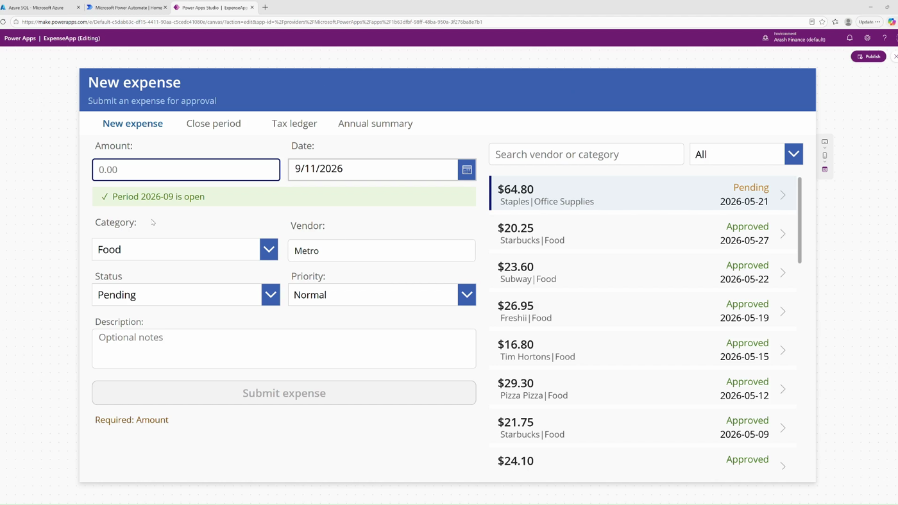
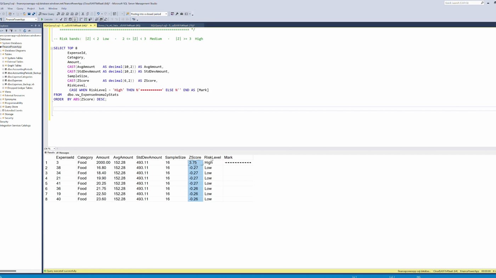
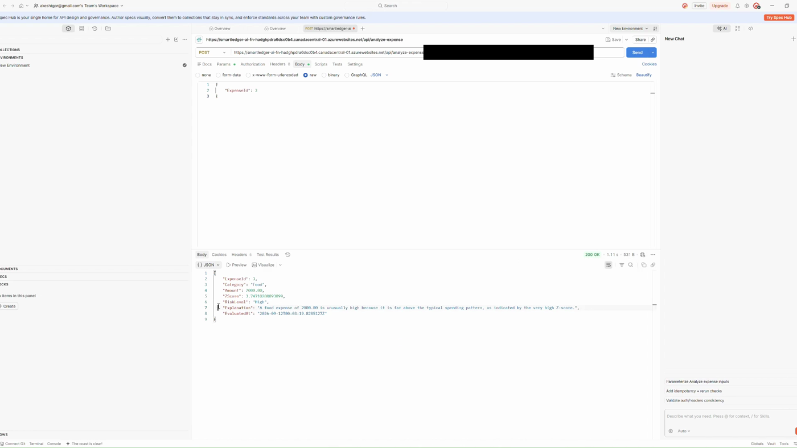
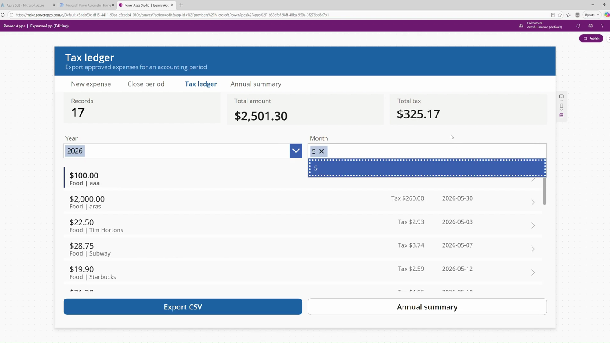

# SmartLedgerAI

Expense management on Power Platform, with statistical anomaly detection and AI-written explanations on Azure.

**▶ 5-minute demo: https://youtu.be/5G1gZIr2gEw**

Two systems on one Azure SQL database:

| Part | What it does |
|---|---|
| **ExpenseApp** (Power Apps) | Expense entry with validation, an approval workflow, accounting-period close, a tax ledger, and CSV export through Power Automate |
| **SmartLedgerAI** (.NET Azure Function) | Scores every expense against its own category-and-month baseline and asks Azure OpenAI to explain the ones that stand out |



## How the analysis works

```
POST /api/analyze-expense   { "ExpenseId": 3 }
        │
        ▼
Azure Function (.NET 8, isolated worker)
        │
        ├─ parameterized query → Azure SQL view  dbo.vw_ExpenseAnomalyStats
        │     AVG / STDEV / COUNT per category, year, month  →  Z-Score  →  RiskLevel
        │
        └─ RiskLevel != "Low"  →  Azure OpenAI (chat completions)
                                   one sentence a finance approver can act on
        ▼
200 OK  { ExpenseId, Category, Amount, ZScore, RiskLevel, Explanation, EvaluatedAt }
```

The statistics live in the database, not in the API. The function takes an expense ID and nothing else — an earlier version accepted a caller-supplied Z-Score, which meant the API would believe any number it was given.

| ABS(ZScore) | RiskLevel |
|---|---|
| < 2 | Low |
| 2 – 3 | Medium |
| > 3 | High |




## Control rules

`src/SmartLedgerAI.Functions/Controls/` holds the deterministic exception rules from the finance plan. They are pure functions over loaded ledger data, so each is unit-tested without a database:

| Rule | Flags | Severity |
|---|---|---|
| `DUPLICATE_PAYMENT` | same vendor, amount and invoice number within 90 days | High |
| `NEW_VENDOR_LARGE_PAYMENT` | a vendor's first payment at or above the limit | Medium |
| `MANUAL_ENTRY_TIMING` | manual entry outside business hours, at a weekend, or on the last day of the month | Low |
| `MANUAL_CASH_CONTROL_ACCOUNT` | manual entry posting straight to cash (1000) or control accounts (1100, 1140, 1200) | Medium |
| `THRESHOLD_PROXIMITY` | amount just at or below an approval limit (Medium), or a large round amount (Low) | Medium / Low |
| `BENFORD_FIRST_DIGIT` | a unit-month of payments whose first digits fail Benford (MAD > 0.015, n ≥ 300) | Medium |

Each finding becomes one row in `audit.Exception` ([`sql/audit/`](sql/audit/)), keyed by a fingerprint so a re-scan never duplicates it. Closing requires a resolution, and nobody can close an exception raised on their own work. The language model only explains an exception; it never decides one.

## Database

- **Tables:** `Expenses`, `AccountingPeriods`, `ExpenseCategories` (foreign-key constrained)
- **Views:** `vw_ExpenseAnomalyStats`, `vw_TaxLedger`, `vw_AnnualTaxSummary`, `vw_ExpenseList`, `vw_ExpenseKPI`, `vw_ExpenseStats`, `vw_AccountingPeriodsDisplay`
- **Stored procedures:** `sp_InsertExpense` (validation inside a transaction), `sp_MonthlyTaxSummary`, `sp_AnnualTaxSummary`
- **Trigger:** `trg_BlockChangesOnClosedPeriod` — once a period is closed, SQL Server itself refuses inserts and updates against it, not the app

The anomaly view is written two ways in [`sql/`](sql/): a CTE with a GROUP BY and a self-join, and a rewrite with `AVG`, `STDEV` and `COUNT` as window functions partitioned by category, year and month — same numbers, no self-join.



## Decisions worth explaining

- **`STDEV`, not `STDEVP`.** A month of expenses is a sample, not the whole population.
- **The divide is guarded.** `STDEV` over a single row returns `NULL`, not zero, so both cases are handled — a `NULLIF` alone would miss one.
- **Only approved expenses inside a period feed the baseline,** so pending records never move the average.
- **The risk label is a contract between layers.** An early window-function draft emitted `'Normal'` where the C# tested for `"Low"` — every transaction would have gone to the AI, silently undoing the cost saving the check exists for. Both views now emit `'Low'`.
- **Sample size matters.** With sample standard deviation, the largest possible Z-Score in a set of *n* rows is `(n-1)/√n` — under twelve rows in a category-month, `High` is arithmetically unreachable.

## Configuration

Set these as Function App application settings (or in `local.settings.json` for local development — see `src/SmartLedgerAI.Functions/local.settings.example.json`):

| Setting | Purpose |
|---|---|
| `SqlConnectionString` | Azure SQL connection string |
| `OPENAI_ENDPOINT` | Azure OpenAI resource endpoint |
| `OPENAI_KEY` | Azure OpenAI API key |
| `OPENAI_DEPLOYMENT` | Chat completion deployment name |

No secrets are committed; `.gitignore` covers `local.settings.json`, publish profiles and build output.

## Error handling

Separate handling for bad JSON (`400`) and unhandled exceptions (`500`), a correlation ID on every request, and a stopwatch logged at completion.

## Repository layout

```
src/SmartLedgerAI.Functions/   the Azure Function
sql/                           anomaly view, both versions
docs/                          screenshots from the demo
```
